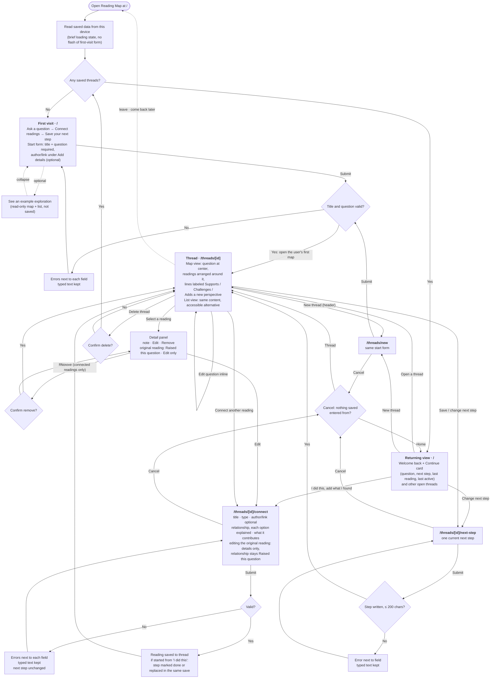

# Reading Exploration Map

A tool that connects what you read with the questions and ideas you want to explore next. Built for
Design, Build, Ship — Assignment 3: Patterns & Flows. Data is saved in your browser with localStorage.

## Run locally

```bash
npm install
npm run dev
```

Then open http://localhost:3000.

## Flows diagram

**Main task:** I add a book and a question it raised → connect another reading and explain what it contributes → save my
next step → return later and continue exploring with my previous work still saved.

The diagram covers the first visit, the main task, the per-thread map, and the returning-user flow. The full
specification (fields, validation messages, empty and error states, map behavior, and routes) is in
[flows.md](flows.md).



## Onboarding research and decisions

We studied how three comparable tools welcome new users: **The StoryGraph** (a reading tracker), **Heptabase** (a visual
whiteboard for learning) and **Are.na** (collecting and connecting saved content). The research used public pages and
documentation only, so screens behind sign-up were not observed. Full findings, evidence labels, and sources are in
[onboarding-research.md](onboarding-research.md).

**Adopted for the first visit:**
- No gate: the home page opens directly on the start form, with no tour, survey, or setup step.
- Only the title and the question are required. Author and link sit under "Add details (optional)".
- One line of verbs teaches the model: *Ask a question → Connect readings → Save your next step.*
- A collapsed, read-only **"See an example exploration"** below the form, kept separate from saved data.
- The first save opens the user's own map, with a neutral primary action, **Connect another reading**. The connect form
  explains all three relationships.
- A relationship and a contribution note are required when connecting. Relationship labels appear on map connections,
  and full notes appear in the detail panel and list view.
- A two-item header, with no videos or separate help pages.

**Deferred:**
- A "Try another" button that cycles example questions. The existing question starters stay.
- A placeholder "Your next reading" node on new maps. The **Connect another reading** action is used instead.

## Local usability test (Step 5)

Another agent tested the running app locally (http://localhost:3102) on October 20, 2026, at 1440 × 900 and
390 × 844. **This was a local test, not the deployed first-run check, which is still pending (see below).**

**Passed and kept as is:** no account or setup gate on the first visit; inline errors that keep typed text and focus the
first invalid field; connecting and editing readings (the original reading keeps its fixed relationship and has no
Remove); map and list show the same readings and notes; next steps, readings, and the Map/List preference survive a
refresh; Enter opens a reading's details and Escape closes them and returns focus; Escape cancels the remove
confirmation.

**Findings and what changed:**

| Finding | Change |
|---|---|
| The example showed one reading raising a question, but not how an exploration continues. | The read-only example now adds a second reading (*The Poetics of Space*) connected as **Challenges**, with its note: "I originally thought… After reading this…". A caption explains: "When you read something related, connect it to your question and note how it changes your thinking." The example is still a constant in the code and is never saved. |
| Supports and Challenges felt ambiguous, because the user never states their current view. | The connect form explains that the choice describes how the reading affects what you currently think, and each option has a concrete example. The contribution field suggests "I originally thought… After reading this…". No new required step; stored relationship values are unchanged. |
| On a phone, the first map pushed the question below the first screen. On desktop, a small map stacked vertically and ran past the bottom of the screen. | On phones the original reading is a compact card with a shorter connector and smaller action buttons, so the reading and the question are visible together. On wide screens, maps with 2–4 readings place readings beside the question instead of above and below it. |
| The map hint said "Select the book…" even for articles. | The hint now says "Select a reading to see your note." |
| Older threads have no visible entry point from home (only the latest is linked). | **Recorded for Step 6:** a Continue card and a list of all saved threads with each question, reading count, and next step. Not changed in this round. |

Rechecked locally after the changes with a scripted run in a fresh browser profile: the core flow (create, validate,
connect, cancel, edit, next step, remove, delete, refresh) still passes at both sizes, plus checks for the four fixes.

## First-run check

_Pending: to be run on the deployed Vercel site after deployment._
