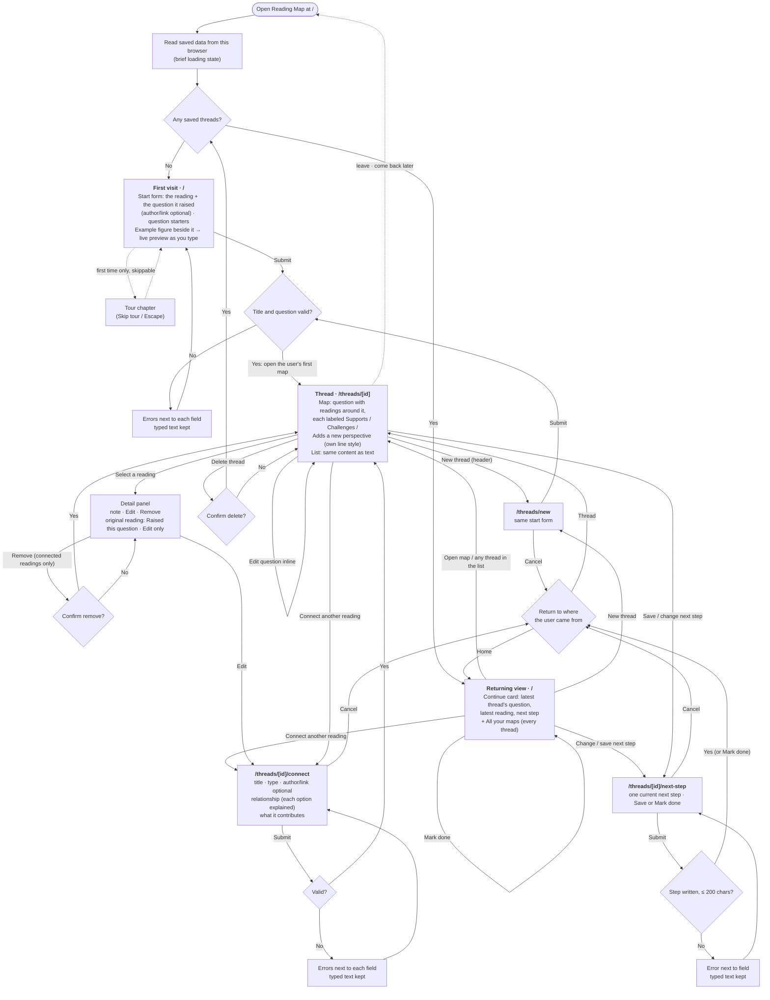

# Reading Exploration Map

A tool that connects what you read with the questions and ideas you want to explore next. Built for
Design, Build, Ship — Assignment 3: Patterns & Flows. Data is saved only in your browser (localStorage), with no
database, accounts, or external APIs. Nothing is stored on a server.

mpcs-51238-project-3.vercel.app

## Run locally

```bash
npm install
npm run dev
```

Then open http://localhost:3000.

## Contents

- [Step 1 — Choosing the tool](#step-1--choosing-the-tool)
- [Step 2 — Flows](#step-2--flows)
- [Step 3 — Onboarding research](#step-3--onboarding-research)
- [Step 4 — First visit](#step-4--first-visit)
- [Step 5 — Core flow, usability test, and first-use tour](#step-5--core-flow-usability-test-and-first-use-tour)
- [Step 6 — Returning experience](#step-6--returning-experience)
- [Step 7 — Accessibility](#step-7--accessibility)
- [First-run check](#first-run-check)

## Step 1 — Choosing the tool

**How the idea was chosen.** Carson brought three ideas to the first planning discussion: **Time Exchange** (making
weekly schedule trade-offs visible), **Skill Tree Studio** (turning a learning goal into a path), and **Reading
Exploration Map**. Claude compared them on weekly usefulness, interaction depth, first-visit value, reasons to return,
and difficulty, and recommended Time Exchange. It noted that Reading Map had the weakest first visit and return trigger,
and risked becoming a tangle as the map grows. **Carson chose Reading Exploration Map**, and the
design was then worked out step by step through discussion and revision. How the current version handles those concerns:
- **First visit:** an example figure and live preview (Step 4).
- **Growing maps:** a List view agreed in Step 2, and compact map layouts added in Step 5.
- **Returning:** a saved next step (Step 2) and a Continue card with a list of every map (Step 6).

**Who it's for:** people who read books and articles and want to follow the questions they raise. In Carson's words,
"users follow a question across books and articles, connect readings that add to or challenge their thinking, and save
a next step."

**The problem:** the original idea was "a tool that connects things people read with the questions and ideas they want to
explore next", where, on returning, people "can see unfinished threads and choose where to continue." Without it,
readings and the questions they raise stay separate, and unfinished threads are easy to lose.

**Core activity:** start from a reading and the question it raised, connect later readings to that question, say how
each one relates (Supports, Challenges, or Adds a new perspective) and what it contributes, and save one next step. The
full sentence is under Step 2.

**Why someone returns:** "I've read something related to an earlier question, or I want to continue the next step I
saved." (Step 6)

## Step 2 — Flows

**Main task:** I add a book and a question it raised → connect another reading and explain what it contributes → save my
next step → return later and continue exploring with my previous work still saved.

The diagram shows the app as it works now. [flows.md](flows.md) is the original Step 2 specification: fields,
validation messages, empty and error states, map behavior, routes, and saved data. Later steps changed some details,
listed under the diagram.



**Changed since the Step 2 specification:**
- The first visit no longer has a verb line or a collapsed example below the form. It shows an example figure beside
  the form instead, which becomes a live preview as you type (Step 4).
- A short, skippable first-use tour was added (Step 5).
- The returning view (Step 6) has a Continue card and an **All your maps** list instead of "other open threads".
  Connecting a reading and completing the next step are separate actions on the card. The specification's combined
  "I did this, add what I found" flow isn't linked from the interface.
- Saving or completing a next step started from home returns home; started from a thread, it returns to the thread.

## Step 3 — Onboarding research

We studied how three comparable tools welcome new users: **The StoryGraph** (a reading tracker), **Heptabase** (a visual
whiteboard for learning) and **Are.na** (collecting and connecting saved content). The research used public pages and
documentation only, so screens behind sign-up were not observed. Full findings, evidence labels, sources and the
original recommendations are in [onboarding-research.md](onboarding-research.md).

| Recommendation | Why (evidence) | Research decision | Later revision |
|---|---|---|---|
| No gate before the start form | All three require an account before any value | Adopted | Still true: no account or setup step. A short first-use tour was added in Step 5. It's skippable and runs once. |
| Only the title and question required | StoryGraph's minimal first action | Adopted | Still true. Author and link sit under "+ Author or link (optional)", and type defaults to Book. |
| Teach the model in one line of verbs | Are.na's five-verb strip | Adopted | Replaced in the Step 4 redesign by the example figure and live preview. |
| Read-only example, collapsed below the form | Heptabase's example boards | Adopted as "See an example exploration" | Replaced in Step 4 by an always-visible example beside the form. Step 5 added a second reading to show how an exploration continues. |
| First save opens the user's own map | Heptabase starts from your own material | Adopted, with the neutral primary action **Connect another reading** | Still true ("Your first map"). |
| Relationship and note required when connecting, shown as labels | Unlabeled arrows in Heptabase's docs; Are.na treats connections as meaningful | Adopted | Still true. Step 5 clarified the options and added an "I originally thought… After reading this…" prompt. |
| A two-item header, no videos or help pages | Heptabase's seven sidebar areas and video-led learning | Adopted | Still true. |
| A "Try another" question shuffle | Are.na's random-title shuffle | Deferred | Not built. The question starters remain. |
| A placeholder "Your next reading" node | Are.na teaches connecting late | Deferred | Not built. The **Connect another reading** action is used instead. |

## Step 4 — First visit

The design is **Concept A, "Editorial Atlas"**: warm paper, ink and oxblood, serif questions, and a reading drawn as a
book linked to its question. It was chosen over a second concept; both mockups are in
[design-concepts/step4/](design-concepts/step4/).

How the current first visit gives value right away:
- **The form is the first thing on the page**, with no account and no setup: the reading, the question it raised, and
  question starters ("Try: …"). Saved data "Stays in this browser · no account".
- **Example figure:** beside the form, a read-only example shows *The Little Prince* raising "What makes a place feel
  like home?". A second reading, *The Poetics of Space*, connects as **Challenges**, with its note. **Use this example**
  copies the example into the form. The example is a constant in the code and is never saved.
- **Live preview:** once you start typing, the figure becomes a preview of your own map ("Not saved") and updates as you
  write.
- **Immediate result:** **Begin the map** saves the thread and opens "Your first map", with **Connect another reading**
  as the next action.
- **Skippable tour:** on the first visit only, a two-step tour highlights the reading and question fields. Skip tour or
  Escape ends it at any step (details in Step 5).

## Step 5 — Core flow, usability test, and first-use tour

The core flow (create, connect, edit, remove, next step, delete) was built as specified in [flows.md](flows.md).

### First-use tour

Each core page has a short tour chapter, shown automatically only the first time that page is visited:
- **Home**, 2 steps: the reading and the question.
- **First thread page**, 3 steps: the question, the connected reading, and **Connect another reading**.
- **Connect page**, 2 steps: the relationship and the note.
- **Next-step page**, 1 step.

Tour buttons never save or change anything. **Skip tour** or Escape ends the current chapter and suppresses the rest.
Finishing a chapter ends only that chapter. Progress is kept under its own key, `reading-map:tour`, so it survives
refreshes. On phones the panel docks to the bottom, and the highlighted element scrolls fully above it.

Verified with a scripted run in fresh browser profiles: **46/46 at 1440 × 900 and 46/46 at 390 × 844**. It covers every
step's text and highlighted element, Back, focus, refresh, Skip from home, and Escape midway through a chapter. The
tour was later made a true modal in Step 7.

### Local usability test

Another agent tested the running app locally (http://localhost:3102) on October 20, 2026, at 1440 × 900 and
390 × 844. **This was a local test, not the deployed first-run check, which is recorded in [First-run check](#first-run-check).**

**Passed and kept as is:** no account or setup gate on the first visit; inline errors that keep typed text and focus the
first invalid field; connecting and editing readings (the original reading keeps its fixed relationship and has no
Remove); map and list show the same readings and notes; next steps, readings, and the Map/List preference survive a
refresh; Enter opens a reading's details and Escape closes them and returns focus; Escape cancels the remove
confirmation.

**Findings and what changed:**

| Finding | Change |
|---|---|
| The example showed one reading raising a question, but not how an exploration continues. | The read-only example now adds a second reading (*The Poetics of Space*) connected as **Challenges**, with its note: "I originally thought… After reading this…". A caption explains: "When you read something related, connect it to your question and note how it changes your thinking." The example is still a constant in the code and is never saved. |
| Supports and Challenges felt ambiguous, because the user never states their current view. | The connect form explains that the choice describes how the reading affects what you currently think, and each option has a one-line description (for example, Challenges: "It makes you reconsider what you currently think."). The contribution field suggests "I originally thought… After reading this…". No new required step; stored relationship values are unchanged. |
| On a phone, the first map pushed the question below the first screen. On desktop, a small map stacked vertically and ran past the bottom of the screen. | On phones the original reading is a compact card with a shorter connector and smaller action buttons, so the reading and the question are visible together. On wide screens, maps with 2–4 readings place readings beside the question instead of above and below it. |
| The map hint said "Select the book…" even for articles. | The hint now says "Select a reading to see your note." |
| Older threads have no visible entry point from home (only the latest is linked). | **Recorded for Step 6:** a Continue card and a list of all saved threads with each question, reading count, and next step. Not changed in this round; addressed in Step 6 (below). |

Rechecked locally after the changes with a scripted run in a fresh browser profile: the core flow (create, validate,
connect, cancel, edit, next step, remove, delete, refresh) still passes at both sizes, plus checks for the four fixes.

## Step 6 — Returning experience

**Reason to come back:** "I've read something related to an earlier question, or I want to continue the next step I
saved."

**Home with no saved threads** is unchanged: the first-visit form, example, and tour chapter.

**Home with saved threads** shows a returning view instead of the creation form:
- **Continue card** for the most recently updated thread: its question, latest reading (with its relationship), reading
  count, and saved next step. Actions: **Connect another reading**, **Open map**, and **Change** or **Mark done** for the
  next step (**Save a next step** when there is none).
- **All your maps**: every saved thread, newest first, with its question, next step (or "No next step"), reading count,
  and when it was last active. Each row opens its map, so older work is always reachable.
- **+ New thread** stays available as a secondary button under the list and in the header. *(Later: renamed "+ New map", and the button under the list was removed. See "Follow-up changes and verification".)*

**Next steps** change only after a successful save: failed validation or Cancel leaves the saved step as it was.
**Mark done** (on the Continue card or the next-step page) completes a step without adding a reading. Saving from home
returns home with a confirmation; saving from a thread returns to that thread.

Data stays in the existing localStorage format (`reading-map:v1`); preferences (`reading-map:pref:*`) and tour progress
(`reading-map:tour`) are untouched.

### Checks performed (local, http://localhost:3102, October 20, 2026)

**Scripted run** in headless Chrome with a fresh, temporary profile, at 1440 × 900 and 390 × 844. **59/59 checks passed at each size**:
- No saved data: the first-visit heading, start form, and home tour chapter appear.
- Three threads created (one from home, two from New thread); all three appear on home, newest first, with reading
  counts and next steps; the Continue card shows the newest; no creation form and no tour on the returning view;
  both New thread entry points present; no horizontal overflow.
- The oldest thread opens from the list; connecting a reading to it moves it to the Continue card with its new latest
  reading and updated count.
- Save a next step from home: empty text fails validation and saves nothing; Cancel saves nothing and the form is empty
  again; a valid save returns home with "Next step saved in this browser." and updates the card.
- Change: the form is prefilled; clearing it fails validation and keeps the old step; Cancel keeps the old step;
  a valid replacement is saved.
- Mark done on the Continue card clears the step without adding a reading and moves focus to the heading; Mark done
  on the next-step page does the same and returns home. Saving from a thread page returns to the thread.
- Refresh keeps the returning view, all three maps, and identical saved data.
- Reopen (Chrome closed and relaunched on the same profile): saved threads, the saved next step, tour progress, and a
  test preference are all kept; no tour appears.
- Header New thread → Cancel returns home; Open map → wordmark returns home.
- Deleting all three threads returns home to the original first-visit form.

The existing scripted runs were rerun afterwards with no changes and no failures: first-use tour 46/46 at each size;
core flow 52/52 on desktop and 51/51 on phone.

**Manual check:** a separate session also exercised the returning paths by hand in the in-app browser at both sizes
(three test threads, continuing an older thread, change/validate/cancel/save, Mark done on the card and on the page,
Cancel from Connect, refresh, and reopening in a new tab), with no problems found.

Not covered: storage failure while returning. Accessibility was audited separately in Step 7.

## Step 7 — Accessibility

Audited locally (http://localhost:3102, October 20, 2026) at 1440 × 900 and 390 × 844, against WCAG 2.2 AA.
No features were added and the design is unchanged.

### Findings and fixes

| Finding | How it was found | Fix |
|---|---|---|
| **Focus was lost after moving to another page.** Following a link whose page then disappears (Open map, Connect another reading, Change next step, an older thread from the list) left focus on the page body, so the next Tab went to the end of the document instead of into the new page. 5 of the 9 navigations tested were affected. | Scripted keyboard run (Enter on each link, then Tab) | After a navigation, if focus would be lost, it moves to the new page's main heading. Focus that a page sets on purpose is left alone: the heading after a save, the tour panel, or a header link that stays on screen. When a tour chapter on a form page closes, focus still goes to the first field. |
| **Map Tab order didn't follow the readings.** On wide screens, maps with 2–4 readings were tabbed column by column (1st, 3rd, 2nd, 4th reading). | Scripted Tab order on a 4-reading map | The nodes now follow the order the readings were added (row by row). Positions on screen are unchanged. |
| **Placeholder text contrast was 3.22:1** (the connect form's "I originally thought… After reading this…", in muted ink at 70% opacity). | Contrast calculation | Uses the full muted ink: **6.30:1**. |
| **The page behind the tour was still reachable.** The tour panel was marked `aria-modal` and kept Tab inside, but the page behind it wasn't inert: a screen reader that ignores `aria-modal` could browse it, and clicking the dimmed page blurred the panel's button, leaving focus on the page body. | Code review; then Chrome's accessibility tree and real clicks in a scripted run | The tour now renders at the end of the page. While a chapter is open, everything else is `inert`: still visible (dimmed, with the spotlight) but not focusable, clickable or exposed to assistive technology. Content added to the page while it's open is made inert too. Clicking the dimmed page keeps focus in the panel. On close, only what the tour made inert is restored, and focus returns as before. |

### Checked and passing (no change needed)

- **Keyboard:**
  - Every Tab stop shows a visible 3px oxblood focus ring, and the order follows the page on the first visit, returning home, map, list, connect form, next-step form and dialogs.
  - "Skip to content" is the first Tab stop.
  - Enter and Space activate buttons. Enter or Space on a map reading opens its details with focus on the title, and Escape closes them and returns focus to the reading.
  - Arrow keys move between relationship options.
  - The Map/List switch works with Space and reports its pressed state.
- **Dialogs:**
  - The remove and delete confirmations open with focus on Cancel and keep Tab inside the dialog. Escape or Cancel closes them, changes nothing, and returns focus to the button that opened them.
  - Edit question's Cancel returns focus to Edit question.
  - The tour is a true modal. While a chapter is open, the page behind it is inert, and Tab and Shift+Tab stay in the panel. Skip tour or Escape always closes it, and focus and the page are restored afterwards.
- **Forms:**
  - Every field has a visible label tied to it, and optional fields say "(optional)".
  - The two radio groups (reading type and relationship) are fieldsets with legends, and each relationship option's description is linked to it.
  - Hints and errors are linked to their fields (`aria-describedby`), and invalid fields are marked `aria-invalid`.
  - On a failed submit, typed text is kept, the first invalid field is focused, and the error appears beside it in text.
- **Map:**
  - Each reading is a button whose name gives the title, type, author and relationship, and the selected one is marked as pressed.
  - The **List** view shows the same readings, relationships and full notes as ordinary text.
  - Relationships never rely on color alone: each has a text label and its own line style (solid, dashed, dotted, thin), and the legend names both.
- **Reflow:** no horizontal scrolling at 320 px wide on any page.

### Measured contrast (WCAG 2 formula, actual token colors)

| Text | Background | Ratio | Needed |
|---|---|---|---|
| Ink `#1c1a16` | paper / raised / sunk | 15.30 / 16.38 / 13.85 | 4.5 |
| Muted ink `#5d574c` (hints, meta, tour text) | paper / raised / sunk | 6.30 / 6.75 / 5.71 | 4.5 |
| Oxblood `#9a3b1e` (kicker, annotations, Raised label) | paper / raised / sunk | 6.13 / 6.56 / 5.55 | 4.5 |
| Supports `#3e5c3a` | paper / raised / sunk | 6.61 / 7.08 / 5.99 | 4.5 |
| Challenges `#85540f` | paper / raised / sunk | 5.65 / 6.05 / 5.12 | 4.5 |
| Adds a new perspective `#3d4f7a` | paper / raised / sunk | 7.12 / 7.62 / 6.45 | 4.5 |
| Error `#9b2f22` | paper | 6.55 | 4.5 |
| Saved message `#3e5c3a` | paper | 6.61 | 4.5 |
| Warning `#6b4a0e` | warning box `#f4ead2` | 6.72 | 4.5 |
| Paper on ink (primary button, selected toggle) | ink / hover `#33302a` | 15.30 / 11.58 | 4.5 |
| White on oxblood (skip link) | `#9a3b1e` | 6.96 | 4.5 |
| Placeholder (after fix) | paper | 6.30 (was 3.22) | 4.5 |

Paper is `#f5f0e6`, raised `#fbf8f1`, sunk `#ece5d6`.

| Non-text | Ratio | Needed |
|---|---|---|
| Focus ring (oxblood) against paper / sunk | 6.13 / 5.55 | 3 |
| Field underline, button and map-node borders (ink) | 13.85–15.30 | 3 |
| Relationship lines on the map plate | 5.12–6.45 | 3 |

Three pairs measure under 3:1 but don't carry information on their own:
- **The focus ring next to the ink button (2.50:1):** the ring is offset 2px, so a paper gap separates it from the button and it reads against paper at 6.13:1.
- **The Book/Article toggle's outer border (1.49:1):** the options are identified by their text, and the selected one by its ink fill (15.30:1).
- **The tour spotlight edge against the dimmed page (1.63:1):** it reads at 6.13:1 against the paper inside, and the panel names the highlighted item in text.

### How it was checked

**Automated** (headless Chrome, fresh temporary profiles, both sizes):
- **axe-core 4.10.2**, with the WCAG 2.0/2.1/2.2 A and AA rules plus best practices. It was loaded only into the test browser, not added to the project. It ran on 19 states: first visit (plain, with the tour, with errors, with the live preview), returning home, 1- and 4-reading maps, detail panel, list view, both confirmation dialogs, inline question edit, the connect form (errors, and next-step mode errors), edit original reading, the next-step form with an error, the new-thread page, thread not found, and the thread tour chapter. **0 violations in every state, at both sizes, before and after the fixes.**
- **Keyboard and focus script** using real key presses: Tab order and visible focus on each page, Enter/Space/Escape/arrow keys, dialog focus, tour focus, and focus after 9 navigations. **51/51 at each size** after the fixes. Before the fixes, the same script recorded the lost focus and the column-by-column map order described above.
- **Contrast calculation** from the design tokens (table above), and a reflow check at 320 × 640.
- **Tour as a modal, 60/60 at each size:** home, thread, connect and next-step chapters. For each open chapter:
  - every page element outside the tour is inert and the tour layer isn't;
  - the spotlight still surrounds the explained element;
  - focus starts in the panel, and 6 Tabs plus a Shift+Tab never leave it;
  - Chrome's accessibility tree drops the page's controls (for example "Begin the map" or "Delete thread") but still has the tour dialog;
  - a real click on the spotlighted element does nothing, and focus stays in the panel.

  It also covers Next and Back (with Enter, Space and the mouse), Get started and Got it, Skip tour, and Escape. After each close, nothing is left inert, the controls are back in the accessibility tree, focus returns (reading field, page heading, or first form field), and Tab continues in the page. Leaving a page with the browser's Back button while a chapter is open leaves nothing inert.
- **Regression after all fixes, including the tour change:**
  - axe: 0 violations in all 19 states.
  - Keyboard and focus script: 51/51.
  - Returning experience: 59/59.
  - First-use tour: 46/46.
  - Core flow: 52/52 on desktop and 51/51 on phone.

  These are per size, except the core flow. One phone run of the returning suite stopped early because the script clicked the header link before it had rendered after reopening the browser. I added a wait to the script; the rerun passed 59/59.

**Manual:**
- I reviewed screenshots taken with keyboard focus on representative controls: the primary button, the Book/Article toggle, a map reading, the Map/List switch and a saved-map link. The focus ring was clearly visible on each.
- I read the form, dialog, map and tour code to confirm labels, grouping and error links.

### Remaining limitations

- **No screen reader testing yet** (VoiceOver or NVDA). Names, roles and states were checked through the DOM and axe, not by listening. In particular, whether the page title is announced after navigation hasn't been confirmed by ear.
- **Not tested:**
  - Windows High Contrast / forced colors.
  - Text-only zoom to 200%, and text-spacing overrides.
  - Speech input.
  - Storage-failure states.
- **Development build only:** in the dev build, the Next.js development overlay adds a Tab stop at the end of the page. It isn't part of the production app and was excluded from the checks.

## First-run check

| | |
|---|---|
| **Deployed URL** | https://mpcs-51238-project-3.vercel.app/ |
| **Date** | October 20, 2026 |
| **Tester** | Claude (AI assistant), acting as a new user |
| **Browser** | Headless Chrome with a new, empty profile; 1440 × 900, then 390 × 844 for the return visit |
| **Goal** | Start an exploration from a book, capture the question it raised, connect two related readings with contribution notes, and save a next step. Then close and reopen the site, find the saved work, and continue it. |

### What was attempted

1. **First visit.** The home page opened straight on the form, with an example map beside it and a 2-step tour. I followed
   the tour, then entered *The Sense of an Ending* (book, Julian Barnes) and the question "Can we trust our own memories of
   the people we used to know?". The preview updated as I typed. **Begin the map** opened "Your first map", with a
   "Saved in this browser." confirmation and a 3-step tour of the map.
2. **Main task.** I connected two readings with notes:
   - an article, "Why your memories change every time you recall them", as **Supports**;
   - *Speak, Memory* (book, Vladimir Nabokov) as **Challenges**.

   Each connect page opened with a 2-step tour. I submitted the first form with only a title on purpose: it showed clear
   errors for the relationship and the note and kept the title. After each save, the map showed the new reading, opened
   its note beside the map, and confirmed "Connected “…”. Saved in this browser."
   I then saved the next step "Read the Bartlett 'War of the Ghosts' study…", after a 1-step tour.
3. **Return.** I closed the browser completely, relaunched it on the same profile, and opened the home URL. Home showed
   "Pick up where you left off": a Continue card with the question, latest reading and next step, and **All your maps**.
4. **Continue.** From the card, I connected *Remembering* (Bartlett) as **Adds a new perspective** and replaced the next
   step with "Find a critique of the 'reconstructive memory' idea". Both saves were confirmed. The phone layout of the
   returning home and the map had no sideways scrolling, and readings stack under the question.

**Result:** the goal was completed. **No functional bugs were found.** Twice, text didn't land in a field and a click
didn't register, but both were caused by the test driver (typing before focusing a field, clicking a button that had
just moved), not the app. Each time, the app's validation caught the missing text and kept the other input.

### Observations

**Worked well:** no account or setup step; the example and live preview; required fields kept to a minimum; clear
inline errors that keep input; a confirmation after every save; distinct relationship labels and line styles with a
legend; the returning home leading with the saved work and next step.

**Usability findings, with suggested fixes by priority:**

| Priority | Finding | Suggested fix |
|---|---|---|
| High | **The next step and new readings aren't connected.** I came back to act on my next step and connected the reading it named, but the connect form didn't mention the step. Afterwards the step still showed the reading I had just added, and I had to change it separately. | When connecting from the Continue card (or right after any connect), show the saved next step and offer "Mark it done" / "Replace it" as part of the same save. |
| Medium | **The tour is long:** 8 steps across 4 pages (home 2, map 3, connect 2, next step 1) before the main task feels finished. On desktop, step 1 of the map tour covers the user's own book. | Shorten it, for example to home plus the first map, with brief inline hints on the forms. Place the map-tour panel so it doesn't cover the reading. |
| Medium | **Two names for one thing:** "+ New thread" and "Delete thread", but "Your first map", "Open map" and "All your maps". | Use one term throughout (for example "map"). |
| Medium | **Small text fields:** the next-step field is one line, so a longer step is cut off while editing ("…changes memor"). The contribution box shows 2 lines, so a two-sentence note scrolls inside it. | Make the next step a short multi-line field, and let the note box grow or start at 3–4 lines. |
| Low | The note field is described three ways: "What does it contribute?", "How it changes your thinking", and the error "Say what this reading adds or challenges." | Use one phrasing, for example "Say how it changes your thinking." |
| Low | After a validation error, the page scrolls so the focused title field is at the very top and its label is off-screen. | Scroll with a margin so the label and error stay visible. |
| Low | The live preview shows "BOOK" but not the author you entered. | Show the author in the preview, as the saved map does. |
| Low | Cancel is an outlined button on the connect form but a text link on the next-step form. | Use the same style for both. |
| Low | With one map, the returning home repeats it in the Continue card and the list, and shows two "+ New thread" buttons. | Hide the list, or the second button, until there are two or more maps. |
| Low | Long titles are cut off on map cards ("…every time you…"). The full title is in the note panel and the List view. | Acceptable, or allow a third line. |
| Low | After connecting, "Delete thread" sits where the "Connect reading" button was, so it ends up under the pointer. It asks for confirmation, so nothing is lost. | Optional: leave more space above it. |

### Test conditions and scope

**Method (as the assignment asks):**
- **Tester:** Claude, an AI agent, ran the check as a new user, working only from the visible interface. It had prior
  familiarity with the app from helping build it.
- **Browser:** a fresh temporary Chrome profile with no saved app data. The profile and its test data were deleted
  afterwards.
- **Returning later:** simulated by fully closing Chrome and reopening it on the same profile.

**Coverage:**
- **Desktop (1440 × 900):** the first visit, the main task, and the return.
- **Phone size (390 × 844):** only the returning home and the map.
- **Not part of this check:** no physical device or assistive technology was used. A study with a real person,
  physical-phone testing and screen-reader testing aren't required by the assignment and weren't done here.

### Follow-up changes and verification

Made after the first-run check above, which is left as originally recorded. Only the two changes below were made, and
**neither has been rechecked on the deployed site**: every check listed here ran locally on the development server
(http://localhost:3102) in headless Chrome, with fresh temporary profiles, on October 20, 2026. The other first-run
findings are unchanged.

#### 1. Response to usability feedback: writing space

From the first-run finding about small text fields (next step cut off while editing, note scrolling inside a 2-line
box).

**Was text lost?** No; the truncation was **visual only**. Before changing anything, a 184-character next step and a
481-character note were saved, the page was refreshed, and the saved values were compared (desktop, 1440 × 900):
- both were stored in full and identical after the refresh;
- both were shown in full on the map and in the List view;
- the change form reopened with the full next step.

The next step had been a one-line input that scrolled sideways, and the note box was 2 lines tall and scrolled inside.

**Change:**
- The contribution note now shows **4 lines**.
- The next step is now a **2-line field that wraps**.

Labels, hints, validation messages, character limits (200 and 500), saved data and Cancel are unchanged. Longer text
scrolls inside the field. Because the next step is now a multi-line field, Enter adds a line break rather than saving;
this wasn't tested separately.

**Checked locally at 1440 × 900 and 390 × 844** (part of the focused run below; all passed at both sizes):
- **Next step:**
  - a multi-line field with 2–3 visible lines, the same label, hint and required state, within the screen width;
  - empty → the same error, nothing saved;
  - over 200 characters → the limit error, text kept, nothing saved;
  - long text scrolls inside the field;
  - Cancel saves nothing, and Cancel after editing keeps the saved step;
  - 184 characters saved, identical after a refresh and shown in full, and the change form is prefilled with all of it.
- **Note:**
  - at least 4 visible lines, the same placeholder and hint;
  - empty → the same error;
  - over 500 characters → the limit error, text kept;
  - long text scrolls inside the field, with no sideways page scrolling;
  - 481 characters saved, identical after a refresh, and shown in full in the List view.

#### 2. Additional design improvement: welcome animation

This was **Carson's design request, not a finding from the first-run check.** The first version (a fade of about one
second) was revised after Carson found that it "feels abrupt and disappears before the text can be comfortably read."

**As built:**
- **Display:** "Welcome to Reading *Map*" in the existing serif, ink on the paper background with an oxblood *Map*,
  covering the page from the first frame.
- **Timing:** the text fades in over 0.5 s while rising 6px, holds for 1.5 s, and fades out over 0.5 s. Then the paper
  fades (0.3 s) to reveal the page, about **2.8 s** in total, with gentle easing and no bounce, zoom or extra decoration.
- **Once per browser:** remembered under `reading-map:welcome`. Anyone who already has saved data or any tour progress,
  including the earlier single-page tour, never sees it.
- **Dismissal:** possible at any time with a click, Escape, Enter or Space. The text fades first (0.12 s), then the
  paper (0.25 s), starting from wherever the animation is.
- **Reduced motion:** with reduced motion preferred, it's skipped (and recorded as seen) and the home tour opens directly.
- **Into the tour:** the home tour starts only after the welcome has fully closed, with the same steps and Skip behavior.

**Two tour fixes found while reviewing this transition:** both were in the tour itself before the welcome existed, and
both affect the start of every tour chapter.
- **Spotlight slide:** the spotlight slid in from full-screen instead of appearing in place. It's now a separate element
  from the full-screen dim.
- **Phone layout:** on phones, the tour's first frame laid the panel out as on desktop, which scrolled the page and left
  the spotlight trailing. The tour now starts from the real window size.

**Checked locally at 1440 × 900 and 390 × 844:**
- **Focused script, 38/38 at each size** (this run also includes the writing-space checks above):
  - a fresh browser shows the welcome for about 2.8 s and records it;
  - the home tour opens only after the welcome closes, never together, with focus on Next;
  - Next, Back and Skip still work;
  - no welcome after a refresh, or after closing and reopening the browser;
  - the text, font, colors and animation timing are as designed;
  - a click or Escape during the welcome closes it within 0.5 s, and the tour follows without being skipped;
  - with reduced motion, there's no welcome and the tour opens directly;
  - no welcome for people with saved maps, with tour progress only, with the earlier tour key, or with saved data whose
    maps were all deleted.
- **Repeat runs:** 6 fresh-browser runs (3 per size) each showed the welcome for 2.82–2.83 s, with the tour opening as
  it closed, no overlap, and focus on Next.
- **Visual review:** I reviewed the following by eye at both sizes:
  - frames at set points in the animation;
  - real-time screenshot sequences of the natural ending and of an early click, through to the open tour.

  After the fixes, no text shows over the page, the spotlight appears in place, and the page doesn't jump on phone.

**Pending for both changes:**
- a recheck on the deployed site;
- a production build after these changes *(since done: `next build` succeeded after the later follow-up changes in sections 3–4)*;
- testing on physical devices or with assistive technology.

#### 3. Response to usability feedback: the remaining first-run findings

Each fix answers a finding from the original check above. All checks were **local** (development server,
http://localhost:3102, headless Chrome, fresh temporary profiles, 1440 × 900 and 390 × 844). **None has been rechecked on
the deployed site.**

| First-run finding | What changed | Checked locally (both sizes, all passed) |
|---|---|---|
| **Next step and new readings weren't connected** | When the map has a next step, connecting a new reading shows it, with **Keep it** (the default), **Mark it done** or **Replace it**. The choice is applied in the same save as the reading. Replacing a step on its own still happens in the next-step form. | Keep is the default. Keep, Mark done and Replace each save correctly, with confirmations ("Next step marked done." / "Next step replaced."). A failed submit and Cancel leave **all saved data byte-for-byte unchanged**. Replace with no text or with over 200 characters shows an error and saves nothing. The section doesn't appear when there's no next step or when editing a reading. |
| **The tour was long and could cover the reading it explained** | See *Guidance* below. On desktop, the panel is now placed so it covers none of the chapter's highlighted elements. On phones, where the panel docks to the bottom, the element being explained is always fully above it. | Every step of every chapter, by geometry and in screenshots. |
| **"thread" and "map" both used** | "Map" everywhere in the interface, including **+ New map**, **Delete map**, "Delete this map?", "Map deleted." and "Start a new map". Internal names and routes are unchanged. | No "thread" in the visible text, page titles or accessible names of the first visit, the returning home, a map, the connect, next-step and new-map pages, and the not-found page. |
| **Contribution field described three ways** | Label "How does it change your thinking?"; hint "One sentence is enough. Try: …"; error "Write how this reading changes your thinking. One sentence is enough." Saved notes are labeled "How it changes your thinking". | The label, hint, error and saved-note label match. |
| **After an error, the field's label scrolled off-screen** | A focused invalid field now brings its whole block (label, field, error) into view with a margin. | The focused field, its label and its error were all on screen for: missing title, note and relationship (connect); empty next step; empty question (new map); and an emptied question (edit). |
| **The live preview left out the author** | The preview shows the author once entered. | The author appears in the preview. |
| **Cancel looked different across forms** | Every Cancel is the same outlined button. | Identical style on 7 forms and entry points. Each Cancel returns where the form was opened from (map or home) and saves nothing. |
| **With one map, home repeated it and showed two "+ New map" buttons** | See *Home with saved maps* below. | Zero, one and several maps. |
| **Long titles were cut off on map cards** | Cards have room for 3 lines of title. The full title stays in the details panel, the List view and each reading's accessible name. On phones the full title wraps on the card. | A long title shows 3 lines on desktop and wraps in full on phone, and the full title appears in the panel and the List view. |
| **"Delete map" ended up under the pointer after saving a reading** | "Delete map" is right-aligned, away from the connect form's left-aligned save button. The confirmation dialog is unchanged. | After a real click on "Connect reading", the button under the pointer on the map page isn't "Delete map", and their positions don't overlap. The dialog still asks first, and Escape cancels. |

#### 4. Decisions made while reviewing these fixes (Carson's)

**Guidance: short page-specific chapters, kept deliberately.** While addressing the "tour is long" finding, the
walkthrough was briefly cut to the home and first-map chapters, with inline hints on the forms. **Carson decided that
wasn't the experience wanted and restored the page-specific chapters.**

The guidance is therefore four short chapters, each shown once, on the first visit to its page. Each can be skipped,
Skip or Escape ends all of them, and saved progress was left as it was.

| Chapter | Steps |
|---|---|
| Home | The reading, and the question it raised |
| First map | The question, a connected reading, and **Connect another reading** |
| Connect a reading | How it relates, and how it changes your thinking |
| Next step | Saving one thing to explore next |

The "tour is long" finding was addressed through placement and smoother transitions instead of fewer chapters.

**Home with saved maps.** At first the list was hidden when only one map existed. **Carson then decided that "All your
maps" should always show whenever a map exists:** the Continue card is a quick way to resume, and the list is a
consistent place to find saved maps. The extra "+ New map" button under the list stays removed; the header's
"+ New map" is the entry point.

**Relationship radio circles looked clipped.** Carson saw the right side of each circle clipped, including the selected
one.
- **What I found:** the circles were the browser's own drawing of a native radio, scaled into a 16px box with
  `accent-color`. In headless Chrome I couldn't reproduce the clipping at pixel densities of 1, 1.25, 1.5 or 2. No
  ancestor clipped overflow, and the inputs didn't shrink. That suggests a browser- or zoom-dependent rendering of the
  native control.
- **The change:** still a real radio input with its label, but the circle is now drawn by the app (`appearance: none`):
  an ink ring with an ink dot when selected. It's sized in `em`, so it scales with the text and stays centered on the
  first line of its heading. Long labels such as "Adds a new perspective" wrap beside the line sample instead of
  squeezing the circle.
- **Checked:**
  - full circles in all three states at 1440 × 900 and 390 × 844, at four pixel densities;
  - at 150% text size on a 320px-wide screen, where the long label wraps;
  - arrow keys move the selection, and the focus ring shows;
  - the whole option is still clickable.
- **Not yet checked:** the browser in which the clipping was originally seen.

**Smoother links between the welcome, page changes and guidance.** Carson found that the welcome and the guided steps
felt disconnected, including after page changes. Each step now runs in a fixed order, with no added fixed delays:
1. Wait until the target is on the page and visible.
2. Bring it into view (above the docked panel on phones).
3. Wait until it has stopped moving.
4. Then show the spotlight and panel.

On top of that sequence:
- **Opening:** an invisible layer blocks the page from the first frame, so there's no gap between the welcome and the
  guide. Once the target is ready, the dim, spotlight and panel fade in together over 0.2 s.
- **Changing steps:** the panel hides, the spotlight keeps tracking the previous element while the page scrolls, then
  moves to the new one, and the panel fades in when that move ends.
- **Focus:** moving focus to the heading after a page change now gives way to an opening chapter, which focuses its
  panel. On close, focus returns to the form's first field or the page heading.
- **Leaving:** the browser's Back or Forward closes an open chapter first. It isn't marked skipped and doesn't reopen.
- **Unchanged:** reduced motion still skips the welcome and every fade.

**Checked locally, both sizes, fresh temporary profiles:**
- **The full journey:** welcome → home chapter → create a map → map chapter → connect chapter → save a reading → next-step
  chapter. Passed 37/37 at each size. On every animation frame, a recorder confirmed:
  - no overlap between the welcome and the guide, and no frame where neither covers the page;
  - each chapter is shown only once its new page and target are on screen;
  - no panel jumps while visible;
  - the spotlight is always on the element being explained while the panel is showing.

  The same run also checked focus on open and close, cleanup of overlays and blocked content after every close and
  page change, Back and Forward, Skip, Escape, revisits, refresh and reduced motion. It also checked existing
  profiles:
  - one that skipped the guide sees no chapters;
  - one that completed every chapter sees none;
  - one that had seen only the home and map chapters sees just the connect chapter on its next eligible visit, and
    their history isn't reset.
- **Visual review:** real-time screenshot sequences of each transition, reviewed by eye: welcome to the home chapter,
  step changes, the navigations into the map, connect and next-step chapters, and a phone step that needs scrolling.
- **This round's focused checks** (all ten findings, plus home with zero, one and several maps): 58/58 at each size.
- **Regression** (each suite run on its own, with a time limit, against the final code):

  | Suite | Desktop | Phone |
  |---|---|---|
  | Welcome animation and writing space | 38/38 | 38/38 |
  | Tour as a modal (inert page, accessibility tree, Tab trap, all four chapters) | 60/60 | 60/60 |
  | Core flow | 52/52 | 51/51 |
  | Returning home | 59/59 | 59/59 |
  | axe accessibility scan, 19 app states | 0 violations | 0 violations |

  Four test-script expectations were updated to match intended changes, not to hide app failures:
  - **Wording:** the scripts now use the new labels ("map", the contribution wording).
  - **Enter on the next step:** the core flow saves the next step by clicking **Save next step**, because the field is
    now multi-line and Enter adds a line break.
  - **"New map" count:** the returning suite now expects one "New map" link (the header), after the decision to remove
    the extra button.
  - **Spotlight timing:** the tour-modal suite now checks the spotlight once each step has settled, instead of a fixed
    0.4 s after Next. Its first run failed 3 spotlight checks (desktop: connect step 2; phone: home step 2 and connect
    step 2). Each was a step that scrolls, where the new sequencing deliberately waits for the scroll to finish. Once
    settled, the spotlight was on the right element in every case.

  Two earlier attempts to run everything in parallel hung or overlapped with code changes; those results were
  discarded, and every suite above was rerun individually.
- **Production build** (`next build`): succeeded.
