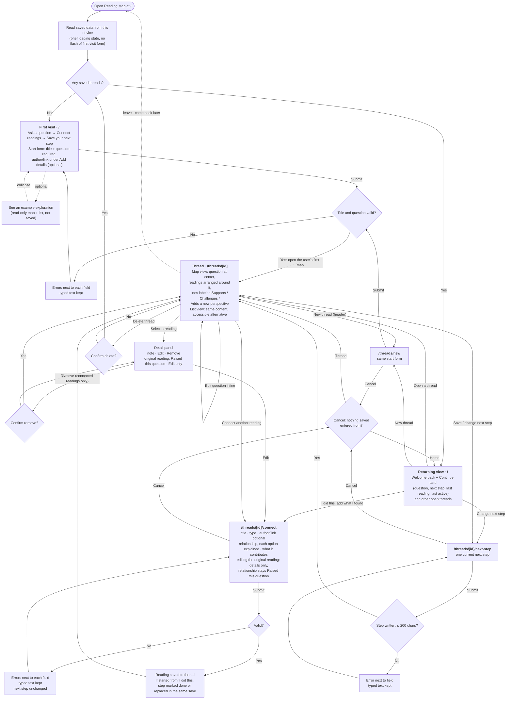
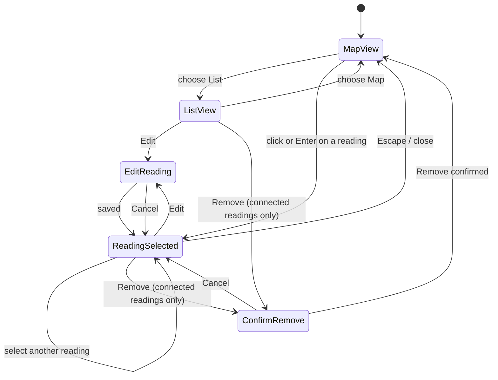
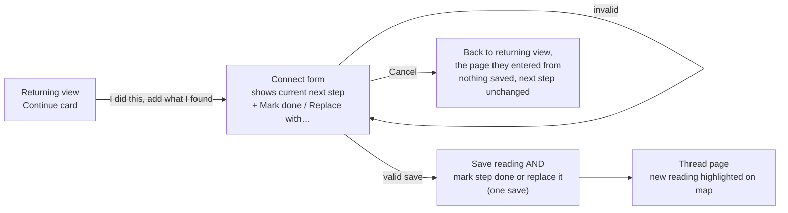

# Reading Exploration Map — Flow Specification

Agreed in planning (Step 2: Define Your Flows). This is the source of truth for the user flows; the main diagram is also
shown in [README.md](README.md).

## Main task

**I add a book and a question it raised → connect another reading and explain what it contributes → save my next step →
return later and continue exploring with my previous work still saved.**

## Example used throughout

Maya is reading *The Buried Giant* (Kazuo Ishiguro) and asks **"How does memory shape identity?"** She later connects a
New Yorker article about Clive Wearing as **Challenges** ("Identity survived even though his memory didn't"), and saves the
next step "Read Locke's memory theory of personal identity." On Sunday she returns, chooses **I did this, add what I
found**, connects Locke as **Supports**, and replaces her next step.

This example is also the read-only example on the home page. It is a fixed constant in the code and is **never written to
the user's saved data**.

---

## Main flow



---

## 1. First visit (`/`, nothing saved)

No gate before the start form: no tour, survey, account, or setup step (R1).

1. Shared header + one line of verbs that teaches the model: *Ask a question → Connect readings → Save your next step*
   (R3). Text only, no tour.
2. **Start form** (one column). Only two required fields are visible (R2):
   - **What are you reading?** Title (required). Type: Book / Article, default Book.
   - **What question did it raise?** (required), with starter chips that prefill the field: "What is the author
     arguing?", "Do I agree with this?", "How does this connect to…?". No shuffle button (R4 deferred).
   - **Add details (optional)**: a collapsed disclosure holding Author and Link.
3. **See an example exploration**: an expandable section below the form, collapsed by default (R5). Shows Maya's thread
   read-only in the same map and list, with all three relationship types. Labeled *Example, not saved*. No edit actions.
4. On valid submit → the user's own new thread page (R6). The map shows the question at the center with their reading
   attached. The primary action is **Connect another reading**, which is deliberately neutral. **Save a next step** is
   the secondary action. There is no placeholder node on the map (R7 deferred).

## 2. Main task — connect a reading (`/threads/[id]/connect`)

Fields, one column:

| Field | Rule | Error text (shown next to the field) |
|---|---|---|
| Title | required | "Enter the title of the reading." |
| Type | Book / Article, default Article | — |
| Author | optional | — |
| Link | optional; if present must start with `http://` or `https://` | "Enter a full link starting with https://." |
| How it relates | required: **Supports**, **Challenges**, **Adds a new perspective** | "Choose how this reading relates to your question." |
| What it contributes | required, 1–500 characters | "Say what this reading adds or challenges — one sentence is enough." |

- The question is shown at the top of the form as context.
- The relationship and the contribution note are both required parts of connecting (R8). Each relationship option
  explains itself under its label:
  - **Supports**: backs up, confirms, or gives evidence for an idea in your question.
  - **Challenges**: questions, contradicts, or complicates your current thinking.
  - **Adds a new perspective**: looks at the question from a different angle, field, or experience.
- Duplicate title already in this thread → "This reading is already in this thread. Edit its note instead." with a link
  that opens it for editing.
- **Edit mode** — opened from the detail panel (`/threads/[id]/connect?reading=<id>`): same form, prefilled, button reads
  **Save changes**.
- **Editing the original reading** (the one that raised the question): same route and form, with these differences:
  - Only the reading's details are edited: Title (required), Type, Author, Link.
  - Its relationship is preserved as **Raised this question**. It is shown as fixed text, not as a choice, and the three
    connection relationships are not offered or required.
  - The contribution note is not required. An optional **Notes** field is offered instead.
  - There is no Remove action for this reading (see §6).
- **Coming from "I did this, add what I found"** (`/threads/[id]/connect?mode=next-step`): the current next step is shown
  at the top, and the form adds one choice:
  - ( ) Mark my next step done
  - ( ) Replace it with: [new next step] — required if chosen: "Write your new next step, or choose 'Mark it done'."

  The next step is only completed or replaced **after the reading is saved successfully**. If validation fails, nothing
  is saved and the next step stays exactly as it was.
- After saving → thread page, the new or edited reading is highlighted and its detail panel is open. A short
  confirmation message is announced ("Connected *Locke on personal identity*").
- Cancel → back to the page the user entered from (home or the thread), nothing saved. See §8.

## 3. Next step (`/threads/[id]/next-step`)

- One current next step per thread. Field: **What will you read or think about next?** (required, ≤ 200 characters,
  visible counter).
  - Empty → "Write one thing to do next, like 'Read chapter 3' or 'Find an article on…'."
  - Too long → "Keep your next step under 200 characters."
- If a step already exists, the form is prefilled and also offers **Mark done** (clears the step without replacing it).
- Saving → thread page with the step pinned near the top. Cancel → back to the page the user entered from (home or the
  thread), nothing saved. See §8.
- History of completed steps is **deferred**.

## 4. The per-thread map

Shown on `/threads/[id]` (and read-only in the home-page example).

- **Layout (automatic, no dragging):** the question is a node at the center; connected readings are placed evenly on a
  circle around it, in the order they were added, starting at the top. The first reading (the one that raised the
  question) is labeled **Raised this question**. If a thread grows past about 8 readings, they continue on a second, outer
  ring.
- **Edges:** each line shows its relationship label in text (Supports, Challenges, Adds a new perspective, or Raised this
  question). Relationship is also shown by line style (Supports = solid, Challenges = dashed, Adds a new perspective =
  dotted) so it never relies on color alone. Nodes show the reading title only. **Full contribution notes appear in the
  detail panel and the list view, not on the map.**
- **Selecting a reading** (click, or Tab to it and press Enter/Space) opens a detail panel next to or below the map:
  title, type, author/link, relationship, contribution note, **Edit** and **Remove**. For the original reading the panel
  shows **Raised this question** and its optional notes, with **Edit** only (no Remove). Escape closes the panel and
  returns focus to the node.
- **Map / List toggle:** the list view shows the same content as a timeline (question, then each reading with its
  relationship label, full contribution note, and the same actions). It is the accessible alternative and works with screen readers and
  keyboard alone. The last choice is remembered on this device.
- The SVG scales to the screen width; on narrow screens the detail panel sits below the map.
- Out of scope: dragging, manual node positions, a global graph across threads.



## 5. Returning (`/`, saved data exists)

1. **Welcome back** heading.
2. **Continue card** — the most recently active thread: question, current next step, last reading added, "Last active 3
   days ago", and a small preview of its map. Actions:
   - **I did this, add what I found** → connect form in next-step mode (see §2).
   - **Change next step** → `/threads/[id]/next-step`.
   - **Open thread** → `/threads/[id]`.
   - If the thread has no next step: "No next step yet" with **Save a next step**.
3. **Other threads** — sorted by last activity, each with its question, next step (or "No next step yet"), and reading
   count.
4. **+ New thread** in the header and below the list.



## 6. Editing and deletion

| What | How | Confirm? |
|---|---|---|
| Question | Inline edit on the thread page (same field component and validation) | No; Cancel restores it |
| Original reading (raised the question) | Detail panel or list → **Edit**: details only (title, type, author, link, optional notes). Relationship stays **Raised this question**; no relationship choice or contribution note required | — |
| Connected reading | Detail panel or list → **Edit**: connect form in edit mode | — |
| Remove a connected reading | Detail panel or list → **Remove** | Yes: "Remove *Clive Wearing article* from this thread? Its note will be deleted." |
| Original reading | **Remove is not offered** (it is the thread's starting point; edit it, or delete the whole thread) | — |
| Next step | `/threads/[id]/next-step` → change or **Mark done** | No |
| Delete thread | Thread page → **Delete thread** | Yes: "Delete this thread, its 3 readings and notes? This can't be undone." → home |

Confirmations use an accessible dialog: focus moves into it, Escape cancels, and focus returns afterwards.

## 7. Empty, error, and system states

| State | What the user sees |
|---|---|
| No saved threads | First-visit start form (never a blank screen) |
| Thread with only the original reading | Map shows question + one reading; primary action **Connect another reading** |
| No next step | "What will you read or think about next?" with **Save a next step** |
| No other threads (returning) | "Start another thread" link instead of an empty list |
| Loading saved data | Brief loading placeholder (prevents a first-visit flash for returning users) |
| Thread not found (bad link, cleared data) | "This thread isn't saved on this device." + **Go home** |
| Reading not found in edit link | "That reading isn't in this thread anymore." + **Back to thread** |
| localStorage unavailable or full | Banner: "Changes can't be saved on this device." Forms still work for this visit |
| Saved data unreadable | "We couldn't read your saved threads." Data is left as is (not overwritten) |

## 8. Routes and shared navigation

| Route | Purpose |
|---|---|
| `/` | First visit (start form + expandable example) or returning view |
| `/threads/new` | Start another thread (same start form component) |
| `/threads/[id]` | Thread hub: map / list toggle, detail panel, next step, edit question, delete thread |
| `/threads/[id]/connect` | Connect a reading; also edit mode (`?reading=`) and next-step mode (`?mode=next-step`) |
| `/threads/[id]/next-step` | Save, change, or mark done the one current next step |

- **Shared header** on every page: **Reading Map** (home) and **+ New thread**, with `aria-current` on the current page.
- **Breadcrumbs** on thread subpages: *Home › How does memory shape identity? › Connect another reading*.

**Cancel and return paths (same rule on every form):**

- **Cancel always returns to the page the user entered the form from**, home or the thread, and saves nothing.
- Links into a form carry where they came from as `returnTo=home` or `returnTo=thread`. Only those two values are
  accepted; anything else is ignored.
- If `returnTo` is missing (for example, a pasted link), Cancel goes to the thread for thread subpages, and home for
  `/threads/new`.

| Form | Entered from | Cancel goes to |
|---|---|---|
| `/threads/[id]/connect` | Thread page (**Connect another reading**, or **Edit** on a reading) | Thread |
| `/threads/[id]/connect?mode=next-step` | Home Continue card (**I did this, add what I found**) | Home |
| `/threads/[id]/next-step` | Thread page | Thread |
| `/threads/[id]/next-step` | Home Continue card (**Change next step** / **Save a next step**) | Home |
| `/threads/new` | Home (**+ New thread**) | Home |
| `/threads/new` | Header **+ New thread** while viewing a thread | That thread |
| Inline question edit | Thread page | Stays on the thread, original question restored |

- After a successful **save**, the user always lands on the thread.
- Browser Back works throughout; a skip-to-content link is the first focusable element.

**Shared components:** Header, Breadcrumbs, Button, TextField, TextArea, RadioGroup (relationship / type), FieldError,
ThreadMap, ThreadList, ReadingDetail, ThreadCard, EmptyState, ConfirmDialog, StorageBanner.

## 9. Saved data (localStorage)

One versioned key, e.g. `reading-map:v1`:

```
{
  threads: [{
    id, question, createdAt, updatedAt,
    readings: [{ id, title, type: "book" | "article", author?, url?,
                 relationship: "raised" | "supports" | "challenges" | "perspective",
                 note?, addedAt }],          // original reading: relationship always "raised",
                                             // note optional; connected readings: note required
    nextStep: { text, setAt } | null
  }]
}
```

Map/List preference is stored separately. Example content is not stored.

## 10. Scope

**In the MVP:** thread creation, the first-visit start form with an expandable read-only example, connecting readings
with a relationship and contribution note, the per-thread map with its list alternative, one current next step, the
returning view, editing and deletion, and essential validation and storage states.

**Deferred:** a "Try another" question shuffle (R4), a placeholder "Your next reading" map node (R7), the "Raises a new
question" relationship, next-step history, a global reading library, reusing readings across
threads, thread statuses, search, export/import, a global cross-thread graph, dragging or manual node positions.
